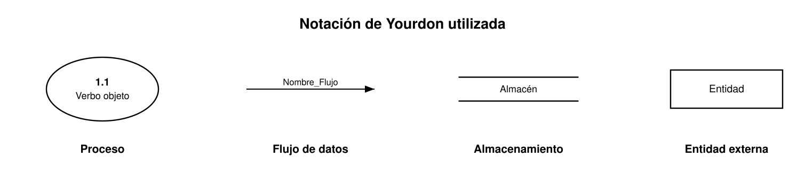
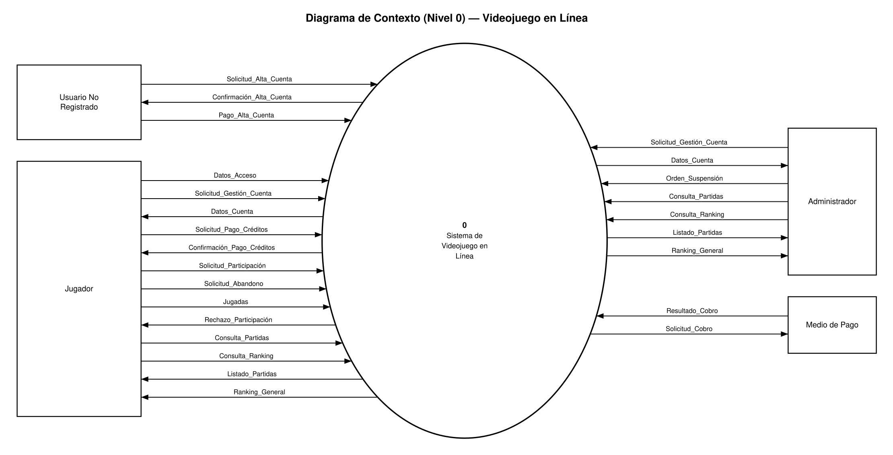
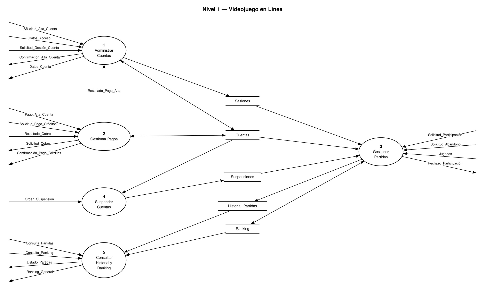
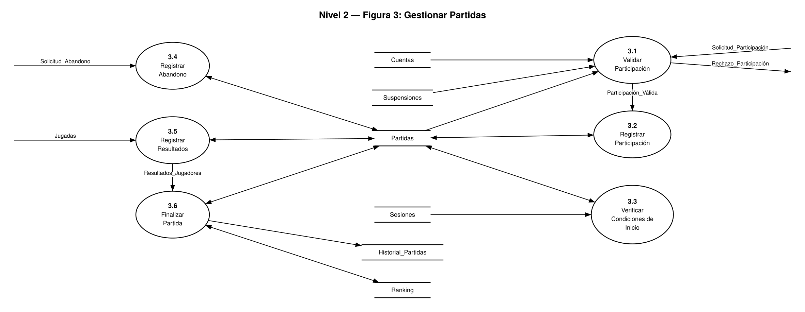
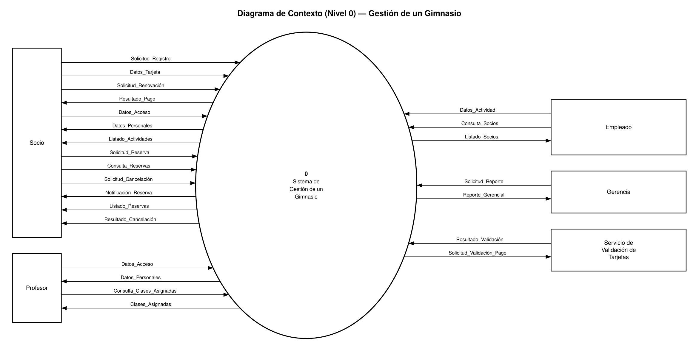
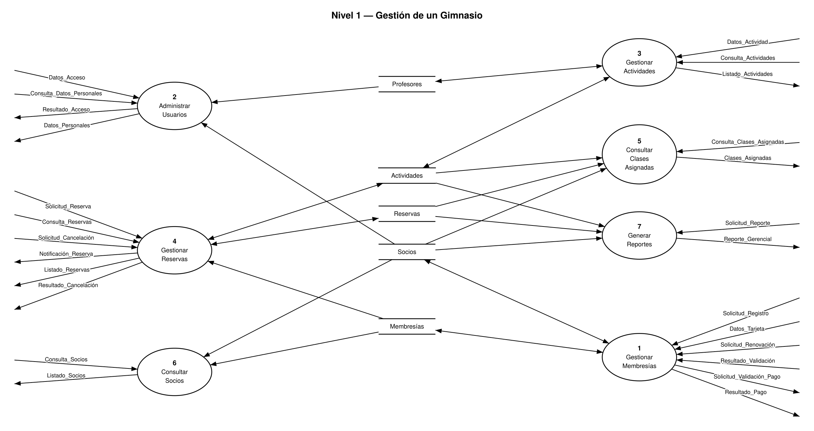
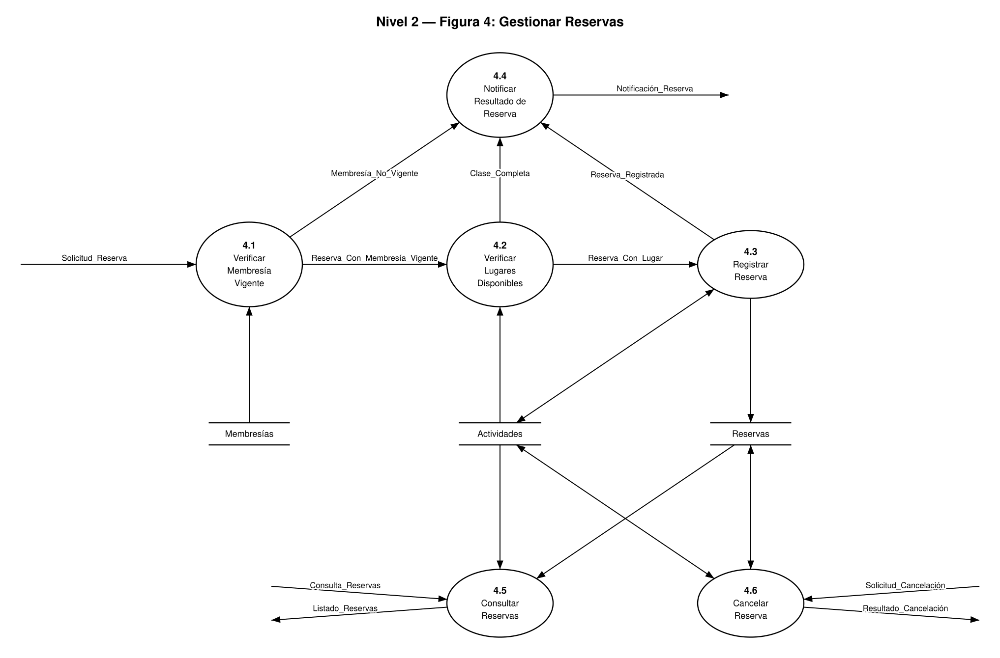

# Trabajo Práctico N° 4 — Diagrama de Flujo de Datos (DFD)

**Licenciatura en Sistemas** · Universidad Nacional de Río Negro, Sede Atlántica
**Materia:** Introducción a la Ingeniería de Software
**Docentes:** Ruiz Héctor · Cayú Gabriela · Malacarne Florencia

## Índice

- [Notación y reglas aplicadas](#notación-y-reglas-aplicadas)
- [Consigna 1: Videojuego en Línea](#consigna-1-videojuego-en-línea)
- [Consigna 2: Sistema de Gestión de un Gimnasio](#consigna-2-sistema-de-gestión-de-un-gimnasio)

---

## Notación y reglas aplicadas

Notación de **Yourdon** (diapositiva "Componentes del DFD" y capítulo 9 de *Análisis Estructurado Moderno*):



| Regla | Fuente |
| --- | --- |
| El proceso se nombra con **verbo en infinitivo + objeto** y se numera según el nivel (0; 1, 2…; 3.1, 3.2…). En el nivel 1 se usan verbos de agrupación (*Gestionar*, *Administrar*) como en la solución de la cátedra; en el nivel 2 verbos específicos. | Cátedra · Yourdon |
| Los flujos llevan un **nombre de dato** (`Nombre_Con_Guion_Bajo`) y conectan solo proceso con entidad, almacén u otro proceso; nunca entidad con entidad, entidad con almacén ni almacén con almacén. | Cátedra · Yourdon |
| Flecha hacia el almacén = **escritura**; desde el almacén = **lectura**; doble punta = lectura y escritura. Las flechas de almacén no se rotulan cuando viaja el registro completo. | Cátedra · Yourdon |
| **Diagrama de contexto**: un solo proceso numerado 0, todas las entidades, sus flujos principales y ningún almacén. | Cátedra |
| De 3 a 9 procesos por diagrama; cada nivel agrega detalle y los diagramas se leen de arriba hacia abajo. | Cátedra · Yourdon |
| **Balanceo**: los flujos de entrada y salida de un proceso del nivel *n* son los de entrada y salida de la figura del nivel *n+1*. | Cátedra · Yourdon |
| Un almacén se muestra en el nivel más alto donde lo comparten dos o más procesos y se repite en los niveles inferiores; si solo lo usan los subprocesos de una figura (almacén local) aparece recién ahí. | Yourdon |
| Sin **agujeros negros** (procesos sin salidas) ni **milagros** (procesos sin entradas); un almacén debe tener al menos una escritura y una lectura en el modelo. | Yourdon |

Las reglas de nomenclatura, cantidad de procesos, balanceo (flujos y almacenes), procesos sin entradas o salidas y uso de almacenes se **verificaron automáticamente** sobre el modelo de ambos sistemas antes de generar los diagramas. Los gráficos están en [`diagramas/`](diagramas/) en PNG y en SVG editable.

---

## Consigna 1: Videojuego en Línea

Se desea modelar un videojuego en línea en el que los jugadores puedan participar en partidas individuales o grupales.

### Alta de cuenta

Para comenzar a utilizar el juego, una persona debe crear una cuenta indicando:

- **Documento**
  - Tipo
  - Número
- **Correo Electrónico**
- **Avatar / Imagen** (optativo)
- **Identificación**
  - Nombre/s
  - Apellido/s
- **Alias** (puede ser 1 o más, hasta 3)
- **Redes Sociales** (opciones: X, Instagram, Otras redes sociales)

En ese momento el sistema le habilitará la opción de **Pago de Créditos**, que podrá realizarlo a través de distintos medios de pago.

### Sesión y créditos

- Una vez registrado, el Jugador puede iniciar sesión y configurar su perfil.
- Cuando lo desee, el Jugador podrá ampliar sus créditos ingresando a la opción del sistema **Pago de Créditos**, pudiendo realizarlo a través de cualquier medio de pago.

### Partidas

Un jugador puede crear una partida o unirse a una partida creada por otro jugador, siempre que:

- existan lugares disponibles,
- no se encuentre suspendido y
- cuente con los créditos necesarios para participar del juego.

Antes de comenzar una partida, el sistema deberá verificar:

- que todos los jugadores necesarios se encuentren conectados y
- que se haya alcanzado la cantidad mínima de participantes.

Si las condiciones se cumplen, la partida podrá comenzar. El Jugador podrá optar por esperar o por abandonar la partida antes que ésta comience.

- Durante el juego, el sistema registra los resultados obtenidos por cada jugador.
- Al finalizar una partida, actualiza el historial y el ranking correspondiente.
- Si un Jugador abandona una partida antes de que finalice, el sistema deberá registrar el abandono y actualizar el resultado correspondiente.

### Administración

- El **Administrador** del juego y el **Jugador** podrán gestionar las cuentas de los jugadores, consultar las partidas realizadas y ver el ranking general de partidas.
- El Administrador podrá suspender temporalmente las cuentas que incumplan las reglas de la plataforma.
- Cuando una cuenta es suspendida, el jugador no podrá iniciar nuevas partidas hasta que finalice el período de suspensión.

### Objetivo

Se solicita modelar el sistema considerando las distintas entidades involucradas, el diagrama de flujo de datos que permita representar las transformaciones que sufren los datos a través de los procesos definidos y un ejemplo de diccionario de datos que muestre una estructura de datos, utilizando la técnica de **Diagrama de Flujo de Datos (DFD)**.

### Actividades

- [x] **a.** Identifique las entidades.
- [x] **b.** Identifique los principales procesos.
- [x] **c.** Realice el Diagrama de Flujo de Datos, incluyendo nivel 0, nivel 1 y, del nivel 2, solo uno de los procesos del nivel 1.
- [x] **d.** Plantee un Diccionario de Datos para el registro de una persona cuando abre una cuenta.

### Resolución

#### a. Entidades

| Entidad | Rol frente al sistema | Qué envía / qué recibe |
| --- | --- | --- |
| **Usuario No Registrado** | Persona que todavía no tiene cuenta: solicita el alta y debe pagarla para que la cuenta se dé de alta. Al completarse el alta pasa a ser Jugador. | Envía la solicitud de alta y el pago del alta. Recibe la confirmación del alta (o el rechazo por pago no aprobado). |
| **Jugador** | Persona con cuenta: inicia sesión, configura su perfil, paga créditos y juega partidas. | Envía datos de acceso, pedidos de pago de créditos, de participación y de abandono, jugadas y consultas. Recibe confirmaciones, rechazos, listado de partidas y ranking. |
| **Administrador** | Gestiona cuentas, suspende cuentas que incumplen las reglas y consulta partidas y ranking. | Envía gestión de cuentas, órdenes de suspensión y consultas. Recibe datos de cuentas, listado de partidas y ranking. |
| **Medio de Pago** | Organización externa por la que se abona el alta de la cuenta y los créditos (cualquier medio de pago). | Recibe la solicitud de cobro y devuelve su aprobación o rechazo. |

No son entidades (están dentro del sistema): **Partida**, **Historial** y **Ranking** son datos que el sistema guarda (almacenes), y **Redes Sociales**, **Documento**, **Alias** o **Avatar** son atributos de la cuenta.

#### b. Procesos principales

| N° | Proceso | Qué hace |
| --- | --- | --- |
| 1 | **Administrar Cuentas** | Alta de cuenta del Usuario No Registrado (una vez acreditado el pago del alta) e inicio de sesión del Jugador; gestión de cuentas (perfil, consulta y modificación) por el Jugador y el Administrador. |
| 2 | **Gestionar Pagos** | Cobro del alta de cuenta al Usuario No Registrado y pago de créditos del Jugador, con cualquier medio de pago; acreditación del saldo en la cuenta. |
| 3 | **Gestionar Partidas** | Creación y unión a partidas, verificación de condiciones, registro de resultados y abandonos, cierre de la partida y actualización de historial y ranking. |
| 4 | **Suspender Cuentas** | Suspensión temporal de cuentas que incumplen las reglas de la plataforma. |
| 5 | **Consultar Historial y Ranking** | Consulta de las partidas realizadas y del ranking general. |

#### c. Diagrama de Flujo de Datos

##### Nivel 0 — Diagrama de contexto

Una sola burbuja numerada con **0** que representa todo el sistema, todas las entidades externas y sus flujos principales; sin almacenamientos.



| Flujo | Origen | Destino | Descripción |
| --- | --- | --- | --- |
| `Solicitud_Alta_Cuenta` | Usuario No Registrado | Sistema (0) | Datos con los que una persona no registrada solicita abrir su cuenta (ver diccionario). |
| `Pago_Alta_Cuenta` | Usuario No Registrado | Sistema (0) | Medio de pago elegido y datos del pago con el que la persona abona el alta de la cuenta. |
| `Datos_Acceso` | Jugador | Sistema (0) | Datos con los que el jugador se identifica para iniciar sesión. |
| `Solicitud_Gestión_Cuenta` | Jugador, Administrador | Sistema (0) | Pedido de configurar el perfil, consultar o modificar una cuenta. |
| `Confirmación_Alta_Cuenta` | Sistema (0) | Usuario No Registrado | Confirma la cuenta creada y habilita la opción de Pago de Créditos (o informa que no se dio de alta por pago rechazado). |
| `Datos_Cuenta` | Sistema (0) | Jugador, Administrador | Datos de la cuenta consultada y confirmación de los cambios realizados. |
| `Solicitud_Pago_Créditos` | Jugador | Sistema (0) | Cantidad de créditos a comprar y medio de pago elegido. |
| `Resultado_Cobro` | Medio de Pago | Sistema (0) | Aprobación o rechazo del cobro informado por el medio de pago. |
| `Solicitud_Cobro` | Sistema (0) | Medio de Pago | Datos del pago (alta de cuenta o créditos) enviados al medio de pago elegido. |
| `Confirmación_Pago_Créditos` | Sistema (0) | Jugador | Confirma el pago y el nuevo saldo de créditos (o informa el rechazo). |
| `Solicitud_Participación` | Jugador | Sistema (0) | Pedido de crear una partida o de unirse a una partida creada por otro jugador. |
| `Solicitud_Abandono` | Jugador | Sistema (0) | Decisión del jugador de abandonar la partida (antes de que comience o durante el juego). |
| `Jugadas` | Jugador | Sistema (0) | Acciones del jugador durante la partida. |
| `Rechazo_Participación` | Sistema (0) | Jugador | Motivo por el que no se puede participar (sin lugares, cuenta suspendida o créditos insuficientes). |
| `Orden_Suspensión` | Administrador | Sistema (0) | Cuenta a suspender, motivo y período de suspensión. |
| `Consulta_Partidas` | Jugador, Administrador | Sistema (0) | Pedido de consulta de las partidas realizadas. |
| `Consulta_Ranking` | Jugador, Administrador | Sistema (0) | Pedido de consulta del ranking general. |
| `Listado_Partidas` | Sistema (0) | Jugador, Administrador | Partidas realizadas y sus resultados. |
| `Ranking_General` | Sistema (0) | Jugador, Administrador | Posiciones del ranking general de jugadores. |

##### Nivel 1

Descompone el proceso 0 en 5 procesos y agrega los almacenamientos que comparten. Los 19 flujos externos del diagrama de contexto se conservan sin cambios (balanceo nivel 0 ↔ nivel 1); aquí se dibujan sin la entidad, como en la solución de la cátedra, y su origen o destino figura en la tabla anterior. Se agrega un flujo entre procesos, `Resultado_Pago_Alta` (2 → 1): el proceso 2 cobra el alta y le informa al proceso 1 si el pago fue aprobado, y recién entonces el proceso 1 da de alta la cuenta.



Flujo entre procesos de esta figura:

| Flujo | De | A | Descripción |
| --- | --- | --- | --- |
| `Resultado_Pago_Alta` | 2 | 1 | Aprobación o rechazo del cobro del alta; la cuenta solo se da de alta si el pago fue aprobado. |

| Almacén | Contenido | Escribe | Lee |
| --- | --- | --- | --- |
| `Cuentas` | Datos de cada cuenta de jugador y su saldo de créditos. | 1, 2 | 1, 2, 3, 4 |
| `Sesiones` | Jugadores con sesión iniciada (conectados). | 1 | 3 |
| `Suspensiones` | Cuentas suspendidas, motivo y período de suspensión. | 4 | 3 |
| `Historial_Partidas` | Partidas finalizadas con el resultado de cada jugador (incluye abandonos). | 3 | 5 |
| `Ranking` | Posición acumulada de cada jugador. | 3 | 3, 5 |

##### Nivel 2 — Figura 3: Gestionar Partidas

Se detalla el proceso **3 Gestionar Partidas** por ser el que concentra las reglas del enunciado (lugares, suspensión, créditos, conexión, mínimo de participantes, abandono, resultados, historial y ranking). Se descompone en 6 subprocesos.



| N° | Proceso | Qué hace |
| --- | --- | --- |
| 3.1 | **Validar Participación** | Verifica lugares disponibles, que la cuenta no esté suspendida y que tenga créditos suficientes. |
| 3.2 | **Registrar Participación** | Crea la partida o suma al jugador a una partida existente. |
| 3.3 | **Verificar Condiciones de Inicio** | Verifica que los jugadores estén conectados y que se alcance el mínimo de participantes; habilita el comienzo de la partida. |
| 3.4 | **Registrar Abandono** | Registra el abandono (antes del comienzo o durante el juego) y actualiza el resultado del jugador. |
| 3.5 | **Registrar Resultados** | Registra los resultados obtenidos por cada jugador durante el juego. |
| 3.6 | **Finalizar Partida** | Cierra la partida y actualiza el historial y el ranking. |

Flujos entre procesos de esta figura:

| Flujo | De | A | Descripción |
| --- | --- | --- | --- |
| `Participación_Válida` | 3.1 | 3.2 | Pedido de participación que cumplió todas las condiciones. |
| `Resultados_Jugadores` | 3.5 | 3.6 | Resultados finales obtenidos por cada jugador de la partida. |

**Balanceo nivel 1 ↔ nivel 2.** Los flujos que entran y salen del proceso 3 son exactamente los que entran y salen de la figura 3:

| Flujo | Sentido | Nivel 1 | Nivel 2 |
| --- | --- | --- | --- |
| `Solicitud_Participación` | Entrada | proceso 3 | 3.1 |
| `Rechazo_Participación` | Salida | proceso 3 | 3.1 |
| `Solicitud_Abandono` | Entrada | proceso 3 | 3.4 |
| `Jugadas` | Entrada | proceso 3 | 3.5 |

Los almacenamientos del proceso 3 se repiten en la figura 3 con el mismo tipo de acceso y aparece además el almacén local `Partidas`, que no se muestra en el nivel 1 porque lo usan solo los subprocesos de esta figura:

| Almacén | Nivel 1 (proceso 3) | Nivel 2 |
| --- | --- | --- |
| `Cuentas` | Lectura | Lectura (3.1) |
| `Suspensiones` | Lectura | Lectura (3.1) |
| `Sesiones` | Lectura | Lectura (3.3) |
| `Historial_Partidas` | Escritura | Escritura (3.6) |
| `Ranking` | Lectura/Escritura | Lectura/Escritura (3.6) |
| `Partidas` | — (almacén local) | Lectura/Escritura (3.1, 3.2, 3.3, 3.4, 3.5, 3.6) |

#### d. Diccionario de datos

Se documenta el registro de una persona cuando abre una cuenta: el flujo de entrada `Solicitud_Alta_Cuenta` y el registro que se guarda en el almacén `Cuentas`.

**Notación:** `=` está compuesto por · `+` y (secuencia) · `[ | ]` selección de alternativas · `( )` opcional · `{ }` repetición, con límites `1{ }3`.

```text
Solicitud_Alta_Cuenta = Documento
                      + Correo_Electrónico
                      + (Avatar)
                      + Identificación
                      + 1{Alias}3
                      + Redes_Sociales

Documento       = Tipo_Documento + Número_Documento
Tipo_Documento  = [ DNI | Pasaporte ]
Identificación  = 1{Nombre}n + 1{Apellido}n
Redes_Sociales  = 1{Red_Social}3
Red_Social      = [ X | Instagram | Otras_Redes_Sociales ]

Cuentas         = {Cuenta}
Cuenta          = Documento + Correo_Electrónico + (Avatar) + Identificación
                + 1{Alias}3 + Redes_Sociales + Saldo_Créditos
```

Datos elementales (longitud y formato son propuestas de diseño: el enunciado solo fija los valores permitidos y la obligatoriedad):

| Dato | Descripción | Tipo | Longitud | Formato |
| --- | --- | --- | --- | --- |
| `Tipo_Documento` | Tipo de documento de identidad | Alfabético | 10 | DNI o Pasaporte |
| `Número_Documento` | Número del documento | Alfanumérico | 20 | Sin puntos ni espacios |
| `Correo_Electrónico` | Correo del jugador | Alfanumérico | 100 | `usuario@dominio` |
| `Avatar` | Imagen de perfil (optativo) | Archivo de imagen | hasta 2 MB | JPG o PNG |
| `Nombre` | Cada nombre de pila | Alfabético | 30 | Texto |
| `Apellido` | Cada apellido | Alfabético | 30 | Texto |
| `Alias` | Nombre público de juego (1 a 3 por cuenta) | Alfanumérico | 20 | Texto |
| `Red_Social` | Red social elegida | Alfabético | 25 | X, Instagram u otra |
| `Saldo_Créditos` | Créditos disponibles; se inicia en 0 | Numérico entero | 9 | Mayor o igual a 0 |

#### Supuestos

- La persona que todavía no tiene cuenta es el **Usuario No Registrado**: solicita el alta y debe pagarla; una vez acreditado el pago la cuenta se da de alta y esa persona pasa a ser **Jugador**. Son entidades distintas porque interactúan con el sistema de forma diferente (el Usuario No Registrado solo puede solicitar y pagar el alta).
- El **pago del alta** se hace con el mismo **Medio de Pago** que los créditos; si el pago es rechazado la cuenta no se da de alta. El importe del alta no se detalla en el enunciado y no se modela.
- No se modela el resultado de la partida como flujo hacia el Jugador: el resultado se registra en el historial y el ranking, que el Jugador consulta con `Consulta_Partidas` y `Consulta_Ranking`.
- **Medio de Pago** se incorpora como entidad externa porque el enunciado indica que el pago se realiza "a través de distintos medios de pago": hay alguien fuera del sistema que cobra y confirma.
- Solo **Avatar** está marcado como optativo; por eso **Redes Sociales** se modela como obligatoria (al menos una de las opciones).
- "Estar conectado" se representa con el almacén `Sesiones`, que se escribe al iniciar sesión y se lee al verificar las condiciones de inicio de la partida.
- Esperar a que comience la partida no genera ningún flujo: solo el abandono es un dato nuevo.
- El enunciado exige que el jugador "cuente con los créditos necesarios"; solo se verifica el saldo, no se modela un descuento porque no se indica.
- Los tipos de documento `DNI | Pasaporte` son los del ejemplo de la cátedra.
- Para no sobrecargar el contexto se omiten flujos que no agregan información propia: el resultado del inicio de sesión (la sesión queda registrada en `Sesiones`), el acceso del Administrador y el aviso de inicio de partida y la notificación del resultado de la partida (el enunciado solo habla de sesión del Jugador y de que la partida "podrá comenzar") y la confirmación de la suspensión.

---

## Consigna 2: Sistema de Gestión de un Gimnasio

Se desea modelar un sistema para la administración de un gimnasio, el cual debe permitir gestionar los socios, las actividades y las reservas de clases.

### Registro y pago de membresía

Las personas interesadas pueden registrarse como usuarios del gimnasio proporcionando sus datos personales y seleccionando un tipo de membresía.

Para completar el registro, el usuario deberá realizar **obligatoriamente** el pago de la membresía con tarjeta de crédito:

1. El sistema solicita los datos de la tarjeta.
2. Los envía al servicio de validación externa.
3. Si la transacción es aprobada, confirma la operación.
4. Si el pago es rechazado, se informa el error y no se habilita la membresía.

Una vez registrados, los usuarios pueden iniciar sesión para acceder a las funcionalidades disponibles.

### Tipos de usuarios

| Usuario | Puede |
| --- | --- |
| **Socio** | Reservar clases y consultar sus actividades |
| **Profesor** | Consultar las clases que tiene asignadas y los socios inscriptos en ellas |

Ambos tipos de usuarios deben poder iniciar sesión y consultar sus datos personales.

### Actividades y reservas

Un socio puede consultar las actividades ofrecidas por el gimnasio, visualizando:

- el nombre de la actividad,
- el profesor responsable,
- los días y horarios disponibles y
- la cantidad de lugares disponibles.

También puede reservar un lugar en una clase. Para realizar una reserva, el sistema deberá verificar que:

- el socio tenga una **membresía vigente** y
- existan **lugares disponibles** en la clase seleccionada.

Si alguna de estas condiciones no se cumple, la reserva no podrá realizarse.

Una vez realizada una reserva, el socio puede:

- consultar sus reservas,
- cancelar aquellas que todavía no hayan comenzado y
- renovar su membresía.

Para renovar su membresía, el socio deberá realizar **obligatoriamente** el pago de la renovación con tarjeta de crédito. Durante el pago, el sistema solicita los datos de la tarjeta, los envía al servicio de validación externa y, si la transacción es aprobada, confirma la operación. Si el pago es rechazado, se informa el error y no se renueva la membresía.

### Empleado del gimnasio

El empleado es responsable de administrar las actividades. Puede:

- registrar nuevas actividades,
- modificar sus datos,
- establecer los horarios, profesores y cupos disponibles,
- consultar el listado de socios y
- verificar el estado de sus membresías.

Los datos que identifican a una actividad son los siguientes:

- **Código de Actividad**
- **Denominación de la Actividad**
- **Tipo de Actividad**, que puede ser Funcional, Aparatos, Boxeo y Artes Marciales
- **Profesores** (puede ser uno o más, hasta dos)
  - Nombre/s
  - Apellido/s
  - Especialidad
- **Días y horarios** (hasta 3 clases semanales)
  - Día
  - Hora desde
  - Hora hasta
- **Lugar de la actividad** (no obligatorio)
- **Cupos disponibles**

### Gerencia

La gerencia puede consultar reportes sobre la cantidad de socios y las actividades con mayor cantidad de reservas.

### Notificaciones al socio

- Si un socio intenta reservar una clase sin tener una membresía vigente, el sistema informará la situación y no permitirá completar la reserva.
- Si la clase se encuentra completa, el sistema informará que no existen lugares disponibles.

En todos los casos le notifica al Socio.

### Objetivo

Se solicita modelar el sistema utilizando la técnica de **Diagrama de Flujo de Datos (DFD)**.

### Actividades

- [x] **a.** Identifique las entidades.
- [x] **b.** Identifique los principales procesos.
- [x] **c.** Realice el Diagrama de Flujo de Datos, incluyendo nivel 0, nivel 1 y, del nivel 2, solo uno de los procesos del nivel 1.
- [x] **d.** Plantee un Diccionario de Datos para el registro de una actividad.

### Resolución

#### a. Entidades

| Entidad | Rol frente al sistema | Qué envía / qué recibe |
| --- | --- | --- |
| **Socio** | Persona interesada que se registra, paga su membresía y, ya registrada, consulta actividades y reserva clases. | Envía solicitud de registro, datos de tarjeta, renovación, datos de acceso, pedidos de reserva, consulta y cancelación. Recibe resultado del pago, datos personales, listados y notificaciones. |
| **Profesor** | Inicia sesión, consulta sus datos personales y las clases que tiene asignadas con sus inscriptos. | Envía datos de acceso y la consulta de clases. Recibe sus datos personales y las clases asignadas. |
| **Empleado** | Administra las actividades y consulta socios y el estado de sus membresías. | Envía datos de actividad y consulta de socios. Recibe el listado de socios. |
| **Gerencia** | Consulta reportes de gestión. | Envía solicitud de reporte. Recibe cantidad de socios y actividades con más reservas. |
| **Servicio de Validación de Tarjetas** | Servicio externo que aprueba o rechaza las transacciones con tarjeta de crédito. | Recibe los datos de la tarjeta y el importe; devuelve la aprobación o el rechazo. |

No son entidades (están dentro del sistema): **Actividad**, **Reserva** y **Membresía** son datos que el sistema guarda (almacenes), y **Tarjeta de crédito** es un dato que viaja en un flujo.

#### b. Procesos principales

| N° | Proceso | Qué hace |
| --- | --- | --- |
| 1 | **Gestionar Membresías** | Registro del socio con su tipo de membresía, cobro obligatorio con tarjeta de crédito (validación externa) y renovación. |
| 2 | **Administrar Usuarios** | Inicio de sesión del socio y del profesor y consulta de sus datos personales. |
| 3 | **Gestionar Actividades** | Alta y modificación de actividades (horarios, profesores, cupos) y listado de las actividades ofrecidas. |
| 4 | **Gestionar Reservas** | Reserva, consulta y cancelación de reservas; notificación al socio. |
| 5 | **Consultar Clases Asignadas** | Consulta de las clases asignadas al profesor y de los socios inscriptos en ellas. |
| 6 | **Consultar Socios** | Listado de socios y verificación del estado de sus membresías. |
| 7 | **Generar Reportes** | Reportes de cantidad de socios y de actividades con más reservas. |

#### c. Diagrama de Flujo de Datos

##### Nivel 0 — Diagrama de contexto

Una sola burbuja numerada con **0** que representa todo el sistema, todas las entidades externas y sus flujos principales; sin almacenamientos.



| Flujo | Origen | Destino | Descripción |
| --- | --- | --- | --- |
| `Solicitud_Registro` | Socio | Sistema (0) | Datos personales de la persona interesada y tipo de membresía elegido. |
| `Datos_Tarjeta` | Socio | Sistema (0) | Datos de la tarjeta de crédito con la que se paga el registro o la renovación. |
| `Solicitud_Renovación` | Socio | Sistema (0) | Pedido del socio de renovar su membresía. |
| `Resultado_Validación` | Servicio de Validación de Tarjetas | Sistema (0) | Transacción aprobada o rechazada, informada por el servicio externo. |
| `Solicitud_Validación_Pago` | Sistema (0) | Servicio de Validación de Tarjetas | Datos de la tarjeta e importe enviados al servicio de validación externa. |
| `Resultado_Pago` | Sistema (0) | Socio | Confirmación de la operación (membresía habilitada o renovada) o error por pago rechazado. |
| `Datos_Acceso` | Socio, Profesor | Sistema (0) | Datos con los que el usuario se identifica para iniciar sesión. |
| `Datos_Personales` | Sistema (0) | Socio, Profesor | Datos personales del socio o del profesor que inició sesión. |
| `Datos_Actividad` | Empleado | Sistema (0) | Alta o modificación de una actividad: código, denominación, tipo, profesores, horarios, lugar y cupos. |
| `Listado_Actividades` | Sistema (0) | Socio | Nombre, profesor responsable, días y horarios y lugares disponibles de cada actividad. |
| `Solicitud_Reserva` | Socio | Sistema (0) | Pedido de reservar un lugar en una clase. |
| `Consulta_Reservas` | Socio | Sistema (0) | Pedido de consulta de las reservas del socio. |
| `Solicitud_Cancelación` | Socio | Sistema (0) | Pedido de cancelar una reserva. |
| `Notificación_Reserva` | Sistema (0) | Socio | Informa al socio el resultado de la reserva: confirmada, membresía no vigente o clase completa. |
| `Listado_Reservas` | Sistema (0) | Socio | Reservas del socio. |
| `Resultado_Cancelación` | Sistema (0) | Socio | Cancelación confirmada o rechazada por haber comenzado ya la clase. |
| `Consulta_Clases_Asignadas` | Profesor | Sistema (0) | Pedido del profesor de consultar sus clases asignadas. |
| `Clases_Asignadas` | Sistema (0) | Profesor | Clases asignadas al profesor y socios inscriptos en cada una. |
| `Consulta_Socios` | Empleado | Sistema (0) | Pedido de listado de socios y estado de sus membresías. |
| `Listado_Socios` | Sistema (0) | Empleado | Socios y estado de su membresía. |
| `Solicitud_Reporte` | Gerencia | Sistema (0) | Pedido de reportes de gerencia. |
| `Reporte_Gerencial` | Sistema (0) | Gerencia | Cantidad de socios y actividades con mayor cantidad de reservas. |

##### Nivel 1

Descompone el proceso 0 en 7 procesos y agrega los almacenamientos que comparten. Los 22 flujos externos del diagrama de contexto se conservan sin cambios (balanceo nivel 0 ↔ nivel 1); aquí se dibujan sin la entidad, como en la solución de la cátedra, y su origen o destino figura en la tabla anterior.



| Almacén | Contenido | Escribe | Lee |
| --- | --- | --- | --- |
| `Socios` | Datos personales de cada socio. | 1 | 1, 2, 5, 6, 7 |
| `Membresías` | Tipo, vigencia y estado de la membresía de cada socio. | 1 | 1, 4, 6 |
| `Profesores` | Datos de cada profesor: nombre/s, apellido/s y especialidad. | 3 | 2, 3 |
| `Actividades` | Actividades ofrecidas: código, denominación, tipo, profesores, horarios, lugar y cupos disponibles. | 3, 4 | 3, 4, 5, 7 |
| `Reservas` | Reservas de los socios sobre las clases de las actividades. | 4 | 4, 5, 7 |

##### Nivel 2 — Figura 4: Gestionar Reservas

Se detalla el proceso **4 Gestionar Reservas** por ser el que concentra las reglas del enunciado (membresía vigente, lugares disponibles, cancelación de reservas que no comenzaron y notificación al socio en todos los casos). Se descompone en 6 subprocesos.



| N° | Proceso | Qué hace |
| --- | --- | --- |
| 4.1 | **Verificar Membresía Vigente** | Verifica que el socio tenga una membresía vigente. |
| 4.2 | **Verificar Lugares Disponibles** | Verifica que existan lugares disponibles en la clase seleccionada. |
| 4.3 | **Registrar Reserva** | Registra la reserva y descuenta un lugar de los cupos de la actividad. |
| 4.4 | **Notificar Resultado de Reserva** | Informa al socio el resultado en todos los casos: reserva confirmada, membresía no vigente o clase completa. |
| 4.5 | **Consultar Reservas** | Devuelve las reservas del socio. |
| 4.6 | **Cancelar Reserva** | Cancela una reserva que todavía no comenzó y libera el lugar. |

Flujos entre procesos de esta figura:

| Flujo | De | A | Descripción |
| --- | --- | --- | --- |
| `Reserva_Con_Membresía_Vigente` | 4.1 | 4.2 | Pedido de reserva cuyo socio tiene la membresía vigente. |
| `Membresía_No_Vigente` | 4.1 | 4.4 | Aviso de que la membresía del socio no está vigente. |
| `Reserva_Con_Lugar` | 4.2 | 4.3 | Pedido de reserva sobre una clase con lugares disponibles. |
| `Clase_Completa` | 4.2 | 4.4 | Aviso de que la clase no tiene lugares disponibles. |
| `Reserva_Registrada` | 4.3 | 4.4 | Aviso de que la reserva quedó registrada. |

**Balanceo nivel 1 ↔ nivel 2.** Los flujos que entran y salen del proceso 4 son exactamente los que entran y salen de la figura 4:

| Flujo | Sentido | Nivel 1 | Nivel 2 |
| --- | --- | --- | --- |
| `Solicitud_Reserva` | Entrada | proceso 4 | 4.1 |
| `Notificación_Reserva` | Salida | proceso 4 | 4.4 |
| `Consulta_Reservas` | Entrada | proceso 4 | 4.5 |
| `Listado_Reservas` | Salida | proceso 4 | 4.5 |
| `Solicitud_Cancelación` | Entrada | proceso 4 | 4.6 |
| `Resultado_Cancelación` | Salida | proceso 4 | 4.6 |

Los almacenamientos del proceso 4 se repiten en la figura 4 con el mismo tipo de acceso (no hay almacenes locales en esta figura):

| Almacén | Nivel 1 (proceso 4) | Nivel 2 |
| --- | --- | --- |
| `Membresías` | Lectura | Lectura (4.1) |
| `Actividades` | Lectura/Escritura | Lectura/Escritura (4.2, 4.3, 4.5, 4.6) |
| `Reservas` | Lectura/Escritura | Lectura/Escritura (4.3, 4.5, 4.6) |

#### d. Diccionario de datos

Se documenta el registro de una actividad: el flujo de entrada `Datos_Actividad` y el registro que se guarda en el almacén `Actividades`.

**Notación:** `=` está compuesto por · `+` y (secuencia) · `[ | ]` selección de alternativas · `( )` opcional · `{ }` repetición, con límites `1{ }3`.

```text
Datos_Actividad    = [ Alta | Modificación ] + Actividad

Actividades        = {Actividad}
Actividad          = Código_Actividad
                   + Denominación_Actividad
                   + Tipo_Actividad
                   + 1{Profesor}2
                   + 1{Clase}3
                   + (Lugar_Actividad)
                   + Cupos_Disponibles

Tipo_Actividad     = [ Funcional | Aparatos | Boxeo | Artes_Marciales ]
Profesor           = 1{Nombre}n + 1{Apellido}n + Especialidad
Clase              = Día + Hora_Desde + Hora_Hasta
Día                = [ Lunes | Martes | Miércoles | Jueves | Viernes | Sábado | Domingo ]
```

Datos elementales (longitud y formato son propuestas de diseño: el enunciado solo fija los valores permitidos y la obligatoriedad):

| Dato | Descripción | Tipo | Longitud | Formato |
| --- | --- | --- | --- | --- |
| `Código_Actividad` | Identifica a la actividad | Alfanumérico | 6 | Único por actividad |
| `Denominación_Actividad` | Nombre de la actividad | Alfanumérico | 50 | Texto |
| `Tipo_Actividad` | Clasificación de la actividad | Alfabético | 15 | Funcional, Aparatos, Boxeo o Artes Marciales |
| `Nombre` | Cada nombre de pila del profesor | Alfabético | 30 | Texto |
| `Apellido` | Cada apellido del profesor | Alfabético | 30 | Texto |
| `Especialidad` | Especialidad del profesor | Alfabético | 40 | Texto |
| `Día` | Día de la semana de la clase | Alfabético | 9 | Lunes a Domingo |
| `Hora_Desde` | Hora de inicio de la clase | Hora | 5 | `HH:MM` (24 hs) |
| `Hora_Hasta` | Hora de fin de la clase | Hora | 5 | `HH:MM` (24 hs), posterior a `Hora_Desde` |
| `Lugar_Actividad` | Lugar donde se dicta (no obligatorio) | Alfanumérico | 40 | Texto |
| `Cupos_Disponibles` | Lugares disponibles en la actividad | Numérico entero | 3 | Mayor o igual a 0 |

#### Supuestos

- La persona interesada se convierte en **Socio** al registrarse, por eso hay una única entidad para ambos momentos.
- Solo **Socio** y **Profesor** inician sesión, porque son los "tipos de usuarios" que define el enunciado; el Empleado y la Gerencia interactúan sin proceso de acceso.
- Los datos del profesor (nombre/s, apellido/s, especialidad) se informan junto con la actividad, por eso el proceso 3 también escribe en `Profesores`.
- El importe a cobrar surge del tipo de membresía elegido o renovado; no se modela una tarifa aparte.
- Los pedidos de datos de tarjeta que hace el sistema son interfaz de usuario y no se dibujan: el flujo esencial es `Datos_Tarjeta`.
- La cantidad de lugares se descuenta al reservar y se devuelve al cancelar, para poder informar "clase completa".
- Para no sobrecargar el contexto se omiten el resultado del inicio de sesión y los pedidos de datos personales y de actividades: esa información se entrega sin un pedido explícito, como los reportes en la solución de la cátedra (Obra Social).
